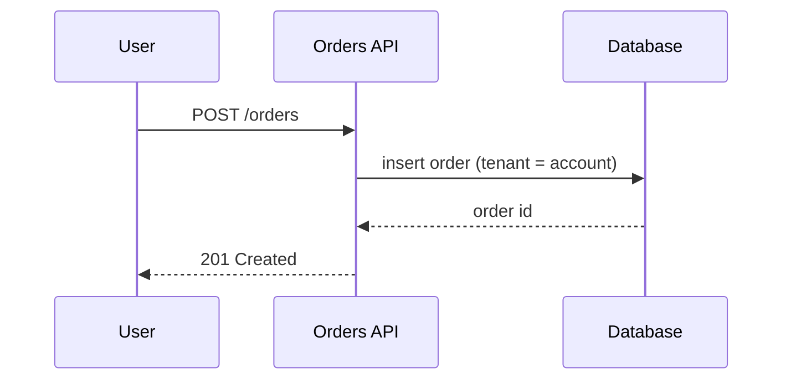
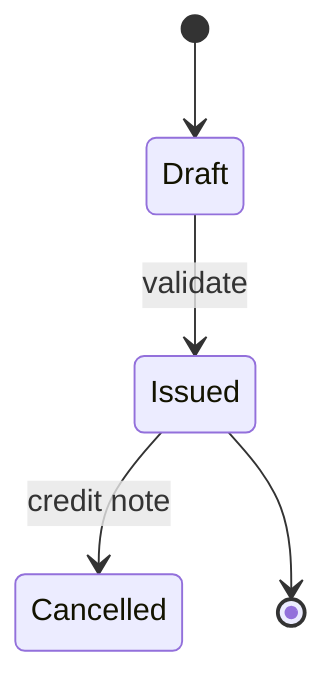

# dynamia-docs:diagrams

A diagram earns its place when it shows **structure or flow that prose makes hard to follow**. If a sentence does it, skip the diagram. Prefer **text-based diagrams in the repo** (Mermaid in fenced ```mermaid blocks, which GitHub-style Markdown hosts render; check your docs host) so they are reviewed in diffs and updated with the code.

## Pick the type (Mermaid types read from mermaid.js.org on 2026-10-23)
| Show | Use |
|---|---|
| Process or decision flow, a pipeline | **flowchart** (swimlanes for who does what) |
| Who calls whom over time (an API call, a login, a payment) | **sequence** |
| Domain model, classes and relations | **class** |
| Lifecycle of an entity (order, invoice, job) | **state** |
| Tables and relations | **entity relationship** (marked experimental) |
| System context, containers, components | **C4** (experimental) or **architecture** diagrams |
| Timelines and plans | **timeline**, **gantt** |
| Branching strategy | **gitGraph** |
Mermaid supports many more (mindmap, quadrant, sankey, XY chart, kanban, ...); use them only when they answer a question.

## Rules
1. **One idea per diagram**; fewer than about 15 nodes. Split big systems by level: context → containers → one container's components.
2. Label every box and arrow with something meaningful (a verb on arrows); name things as the code does.
3. Show **boundaries**: system vs external, trust boundaries, synchronous vs asynchronous, who owns the data. A tenant or account boundary matters in SaaS.
4. Title + a one-line caption saying what to notice; put the legend in text, not in the picture.
5. **Keep it true**: tie the diagram to a file or ADR and review it when that code changes (`dynamia-docs:audit`); delete diagrams nobody maintains.
6. Quote labels that contain punctuation or parentheses; keep IDs simple (`orderSvc`), put human text in the label. Check the diagram renders (preview or CLI) before committing; a broken diagram renders as an error block.
7. Accessibility: add alt-style text or a short description before the diagram, since not every reader sees it.
8. Security: do not diagram internal hostnames, IPs, credentials or customer names in public repos.

## Examples



## Procedure
1. Ask what question the diagram answers and who reads it.
2. Read the code or the design to extract the real elements; do not draw from memory.
3. Draft in Mermaid, render-check, trim to the point of the question.
4. Place it in the doc next to the text that refers to it, with the caption.

End with one line: what the diagram shows, the sources read, whether it was render-checked.
